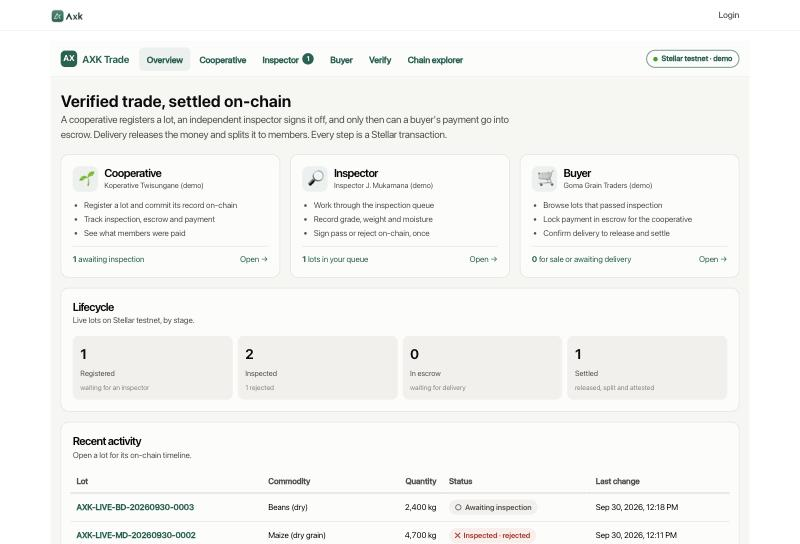
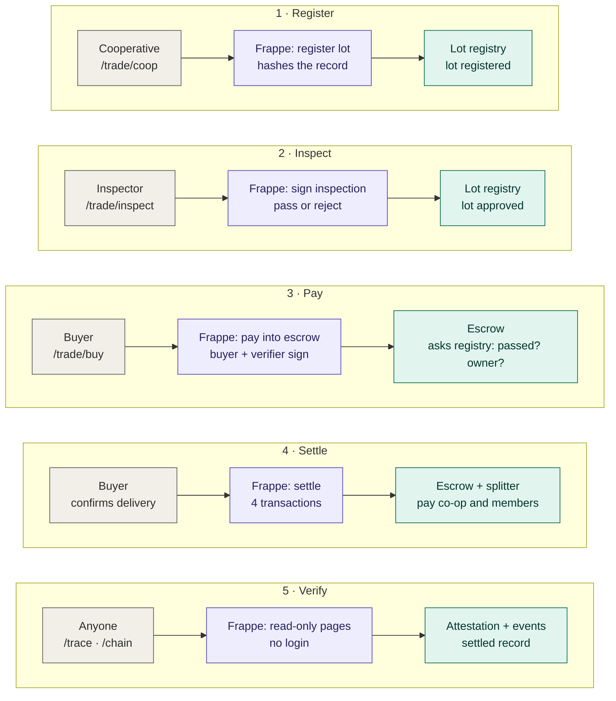
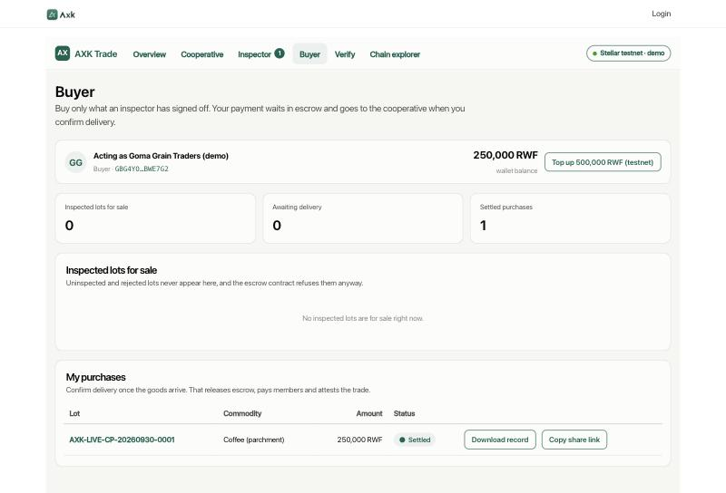
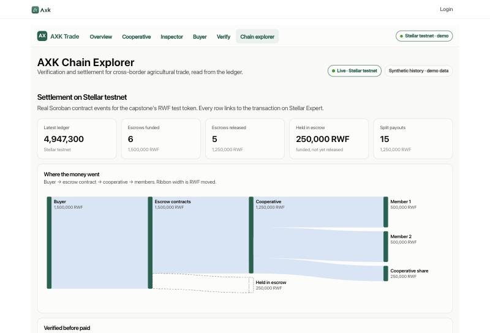

# AXK Network — Verification & Settlement Layer

**Capstone project · BSE Software Engineering (Low-Level / Blockchain track) · African Leadership University · 2026**
Oghenetejiri Jesse · Supervisor: Junior Turatsinze

Cross-border agricultural trade in East Africa fails at two points: a buyer cannot verify a lot's quality and
origin from across a border, and payment is slow, costly and hard to trust. This project puts both in one
workflow on Stellar. A cooperative registers a lot; an independent inspector signs it off on-chain; only then
can a buyer's payment go into a smart-contract escrow, which pays the cooperative that owns the lot, splits
the money to its members, and writes a tamper-evident record anyone can check.

- **Repository:** https://github.com/tejirijesse/axk-capstone
- **Demo video:** _link to be added_
- **Pilot scope:** Kigali cooperatives on the Rwanda–DRC and Rwanda–Uganda corridors



---

## How it works

One trade, top to bottom. In each step a person acts (grey), the Frappe app signs the transaction
(purple), and a Soroban contract on Stellar testnet enforces the rule (green).



1. **Register.** The cooperative commits a SHA-256 digest of the lot record; only the digest goes on-chain.
2. **Inspect.** An authorised inspector, never the lot's owner, signs one pass or reject. It cannot be changed.
3. **Pay.** Escrow asks the lot registry whether the lot passed and who owns it. No pass, no payment; the owner becomes the only possible payee.
4. **Settle.** Confirming delivery releases escrow, records the 40/40/20 split, pays the members and attests the trade.
5. **Verify.** Anyone can read the lot's chain of custody at `/trace` or watch the contracts at `/chain`, without logging in.

Full schematic, message sequence, state machines and data model: [docs/architecture.md](docs/architecture.md).

## What it does

| Role | Screen | What happens on-chain |
|---|---|---|
| Cooperative | `/trade/coop` | Registers a lot: a SHA-256 digest of the lot record is committed to the **lot registry** under an id bound to the cooperative's address |
| Inspector | `/trade/inspect` | Signs one pass/reject inspection (grade, weight, report digest). A cooperative cannot inspect its own lot; a rejection needs a structured reason and is permanent |
| Buyer | `/trade/buy` | Pays into **escrow** — refused unless the lot passed inspection; the payee is fixed to the lot's cooperative. Confirming delivery releases, **splits** 40/40/20 to members and **attests** the trade |
| Anyone | `/trace` | Looks up a lot by reference, digest or transaction hash; sees the chain of custody and QR, with no personal data |
| Anyone | `/chain` | Explorer: live testnet money flow, lot registrations and inspections, an in-browser hash-chain verifier with a tamper test, and a labelled synthetic five-year history |

The four roles are the capstone slice of AXK's fifteen-role product specification: Cooperative Manager,
Human Reviewer (as Inspector), Exporter/Buyer and the public Verification Explorer.

## Screenshots

| | |
|---|---|
|  **Cooperative** — register a lot, follow it to payment |  **Inspector** — oldest-first queue, measured values, pass or reject with a reason (j/k/a/r keys) |
|  **Buyer** — inspected lots only, escrow, confirm delivery, download the verified record, share a link |  **Lot** — seven on-chain steps, records re-hashed in the browser and confirmed by the contracts |
|  **Public trace** — read-only verification with QR, no login |  **Chain explorer** — live Stellar testnet flow and verification events |

## Designs

- [System schematic, trade sequence, state machines and data model](docs/architecture.md)
- [Security: roles, 14 contract guarantees and the test that pins each, application controls, known limits](docs/security.md)
- [Contract reference and design rationale](contracts/README.md)
- [Testnet deployments and what was exercised on-chain](docs/deployments.md)

## Tech stack

| Layer | Technology |
|---|---|
| Smart contracts | Rust, Soroban (`soroban-sdk` 22), `wasm32v1-none` — lot registry, escrow, splitter, attestation |
| Chain | Stellar testnet; RWF test token (Stellar Asset Contract) as the local-currency stand-in |
| Signing | `stellar-cli` 28, custodial per-role testnet identities |
| Application | Frappe v15 + ERPNext v15, Python 3.11, MariaDB 10.11, Redis |
| Frontend | Frappe web pages, vanilla JavaScript, hand-built SVG charts (no chart library) |
| Chain reads | `stellar-sdk` (Python) against Soroban RPC |

## Repository layout

```
contracts/            Soroban workspace: lot_registry, escrow, splitter, attestation (65 tests)
frappe_app/axk_capstone/
  axk_capstone/chain.py        custodial signer: every contract call, argument lists, no shell
  axk_capstone/trade_api.py    role endpoints and the access guard
  axk_capstone/verify.py       public lookup, PII-free fields, QR
  axk_capstone/stellar_live.py Soroban RPC event reader for the explorer
  axk_capstone/www/            /trade/*, /trace/*, /chain pages
  axk_capstone/public/         axk.css, trade.js, chain.css, chain.js
axk_seed/             synthetic five-year dataset + importer (labelled synthetic everywhere)
scripts/demo.sh       deploys fresh contracts and runs one verified trade on testnet
scripts/run-frappe.sh starts the local Frappe stack
docs/                 architecture, security, deployments, screenshots
Makefile              one command per task (`make help`)
```

## Setup

Tested on macOS 15 (Apple silicon) with Homebrew. Every step has a `make` target; `make help` lists them.

### 1. Contracts

```bash
git clone https://github.com/tejirijesse/axk-capstone.git
cd axk-capstone
make toolchain     # rustup, wasm32v1-none target, stellar-cli
make test          # 65 tests
make build         # four wasm files in contracts/target/wasm32v1-none/release/
make demo          # deploy fresh contracts and run a full verified trade on Stellar testnet
```

`make demo` creates and funds its testnet accounts through Friendbot on first run, prints every transaction
link, and saves the contract IDs to `scripts/.demo-state.env`.

### 2. Frappe application

```bash
brew install python@3.11 mariadb@10.11 redis yarn pkg-config mariadb-connector-c
brew services start mariadb@10.11 && brew services start redis
python3.11 -m venv ~/.venvs/bench && ~/.venvs/bench/bin/pip install frappe-bench
export PATH="$HOME/.venvs/bench/bin:$PATH"

cd ~/Documents
bench init axk-bench --frappe-branch v15.104.0 --python python3.11
cd axk-bench
bench get-app erpnext --branch v15.104.0
bench get-app <axk_network repository>          # AXK's platform app (private)
bench new-site axk.localhost --install-app erpnext
bench --site axk.localhost install-app axk_network
```

MariaDB needs `utf8mb4` (see `character-set-server` in `/opt/homebrew/etc/my.cnf`).
Set the site's time zone to `Africa/Kigali` in System Settings.

### 3. Capstone app, contracts and data

```bash
cd ~/Documents/axk-capstone
make install-app        # link frappe_app/axk_capstone into the bench and install it
make contracts-config   # point the site at the contracts from the last `make demo`
make seed               # optional: synthetic five-year history for the explorer
cd ~/Documents/axk-bench && bench --site axk.localhost set-config axk_demo_mode 1
```

### 4. Run

```bash
make run                # http://axk.localhost:8000
```

| Page | URL |
|---|---|
| Overview and roles | http://axk.localhost:8000/trade |
| Public verification | http://axk.localhost:8000/trace |
| Chain explorer | http://axk.localhost:8000/chain |

With `axk_demo_mode: 1`, the role screens work without signing in **from this machine only**; network
requests are refused. On any shared host set it to `0` and sign in as a System Manager.

Running tips:

- **Safari** does not resolve `*.localhost` names. Use `http://localhost:8000/trade` there; Chrome and Firefox accept either.
- The bare address `http://localhost:8000/` is AXK Network's login page, not the capstone. Start at `/trade`.
- `make run` detects a copy that is already running and says so. To restart: `pkill -f 'honcho start'`, then `make run`.
- Keep the `make run` terminal open while using the app; Ctrl+C stops it.

## Walkthrough

1. **Cooperative** → register a lot (e.g. coffee, grade A, 3,850 kg). It appears in the inspector's queue.
2. **Buyer** → the lot is not for sale yet; the escrow contract would refuse payment (`LotNotApproved`).
3. **Inspector** → open the lot, record measured grade, weight and moisture, sign **pass** (or reject with a reason).
4. **Buyer** → the lot is listed as inspected; pay into escrow. Buyer and verifier sign; the payee comes from the registry.
5. **Buyer** → confirm delivery: release, 40/40/20 split, member payouts and the attestation land as four transactions.
6. **Lot page** → seven on-chain steps; *Check records against the chain* re-hashes the records and asks the contracts.
7. **Public trace** → share link or QR; the same evidence with no login and no personal data.
8. **Chain explorer** → the payment flow and the verification events on testnet; tamper with a synthetic event to see the hash chain break.

## Tests

| Suite | Count | Command |
|---|---|---|
| Lot registry | 18 | `cargo test -p axk-lot-registry` |
| Escrow (inspection-gated) | 27 | `cargo test -p axk-escrow` |
| Splitter | 12 | `cargo test -p axk-splitter` |
| Attestation | 8 | `cargo test -p axk-attestation` |
| End-to-end on testnet | 10 steps incl. 4 refusals | `make demo` |

The end-to-end runs and the exact contract error codes observed on-chain are recorded in
[docs/deployments.md](docs/deployments.md).

## Deployment plan

| Stage | Where | What changes |
|---|---|---|
| **1 · Local (now)** | Frappe bench on a laptop · Stellar testnet | Demo mode on loopback only; demo keys in the stellar-cli keystore; synthetic history for the explorer |
| **2 · Pilot (3 months, Kigali)** | One Ubuntu 22.04 VM (2 vCPU, 8 GB) via AXK's Ansible self-host playbook · HTTPS · Stellar testnet | Demo mode **off**; one Frappe user per participant with role permissions; per-role keys moved to a managed key store; nightly backups; an event indexer so history outlives the RPC's ~7-day window; ~30–50 traders and one cooperative |
| **3 · Production** | Managed VM per tenant · Stellar mainnet | External contract audit first; registry admin, verifier, coordinator and attester held by four separately custodied keys; RWF test token replaced by a regulated stablecoin; cash-out to mobile money through a SEP-24 anchor; monitoring and alerting on failed transactions |

**Deploying a release**

```bash
# contracts (per network)
make build
stellar contract deploy --wasm contracts/target/wasm32v1-none/release/axk_lot_registry.wasm \
  --source <admin> --network <net> -- --admin <admin-address>
stellar contract deploy --wasm contracts/target/wasm32v1-none/release/axk_escrow.wasm \
  --source <verifier> --network <net> -- --verifier <verifier-address> --registry <registry-id>
# … splitter (--coordinator) and attestation (--attester) the same way, then add_inspector for each inspector

# application
bench get-app <axk-capstone repository>        # or pull the new tag
bench --site <site> install-app axk_capstone     # first time; `bench --site <site> migrate` after
bench build --app axk_capstone
bench --site <site> set-config --parse axk_stellar '{"network":"<net>","registry":"…","escrow":"…","splitter":"…","attestation":"…","token":"…"}'
bench --site <site> set-config axk_demo_mode 0
bench restart
```

Contracts are immutable once deployed; a new version means new contract IDs and a config change, and trades
already open on the old escrow finish there. Roll back the application with `git checkout <previous-tag>`
followed by `bench --site <site> migrate && bench build`.

## Data honesty

The five-year history on `/chain` (646 lots, 5,258 verification events, 549 orders, 176 escrows) is
**synthetic seed data** generated to populate the demo. Every row is tagged `axk_synthetic_seed = 1` and every
screen that shows it says so. It is not pilot evidence and no finding in the capstone report is drawn from it.
Everything under `/trade` and `/trace`, and the live sections of `/chain`, are real Stellar testnet transactions.

## Provenance

The escrow, splitter and attestation contracts originate in AXK Network, the author's venture
(`AXKNETWORK/axk-stellar`, MIT). In this capstone the escrow was rebuilt around the new lot registry
(inspection gate, payee from the registry, one live escrow per lot). The lot registry, the Frappe app, the
demo script and the explorer were written for this capstone.

## License

MIT — see [LICENSE](LICENSE).
